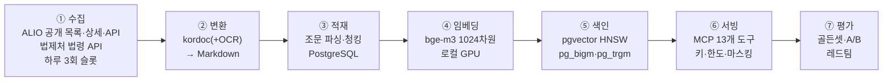

# ALIO RAG

공공기관 **ALIO 공시 문서**(경영공시·기관 내규·단체협약)와 **근거 법령**을 AI 도구에서 조문(청크) 단위로 검색하는 RAG 서비스와 MCP 서버의 설계·구현 공개 저장소입니다.

> 이 저장소는 **문서와 공개용 소스**만 담습니다. 수집한 문서, 변환 결과, DB 덤프, 임베딩 벡터, 평가용 질의·정답 데이터는 **포함하지 않습니다.**
> 이 프로젝트는 **비상업 프로젝트**입니다. 법률·행정 자문이 아닙니다.

- 서비스 안내와 접속 키 신청: <https://mcp.k-union.kr/alio/>
- MCP 엔드포인트: `https://mcp.k-union.kr/alio/mcp` (Streamable HTTP, 접속 키 필요)
- 읽기 전용 · 공공데이터 기반 · 키 신청형 · 베타

## 한눈에 보기

### 규모 (2026-11-26 기준)

공식 집계(2026-11-26 13:10, 정의: 문서 = `documents` 행, 조문·청크 = `articles` 행, 벡터 = 코퍼스별 고유 `text_hash` 합, 공시대상 355곳 기준)입니다.

| 코퍼스 | 내용 | 문서 | 조문·청크 | 벡터 |
|---|---|---:|---:|---:|
| 경영공시 | ALIO 경영공시 자료와 첨부 문서 | 607,629 | 8,754,131 | 4,819,537 |
| 기관 내규 | 취업규칙·인사·보수 규정 등 | 42,629 | 1,945,374 | 1,728,392 |
| 단체협약 | 단체협약·신구대조표 | 21,244 | 461,946 | 156,507 |
| 법령 | 근거 법령(연혁 포함, 법제처) | 3,682 | 551,582 | 64,987 |
| **합계** | | **675,184** | **11,713,033** | **6,769,423** |

- 법령은 «현행 정본 557 + 연혁 3,125 = 3,682문서»(2015년 이후 연혁 포함, 법령 보강 작업 보고서의 전후 표 기준)입니다. `documents.meta.edition_status` 로 직접 집계하면 superseded 3,105 · current 165 · scheduled 110 · 표식 없음 302 로 나오는데, «정본/연혁»과 `edition_status` 는 정의가 달라 합이 같아도 구성이 다릅니다.
- 국가과학기술연구회 소관 출연연 23곳(공공기관 지정 해제, 355곳과 별개)은 별도 범위(`scope=extra`)이며 문서 4,407 · 청크 176,997 · 벡터 169,735입니다. 기본 검색에서는 제외되고 `search_extra` 로만 검색합니다.
- 벡터가 청크보다 적은 이유: 본문이 같은 청크는 `text_hash` 로 벡터를 공유합니다. `article_embeddings` 전체 행(6,949,400)은 출연연 벡터와 현재 청크에 연결되지 않은 임베딩(고아)까지 포함하므로 위 합계와 다릅니다.
- 같은 날 직접 재집계한 DB 값(문서 679,591 = 675,184 + 4,407, 청크 11,890,030 = 11,713,033 + 176,997)은 공식 집계와 일치합니다. 수치는 매일 증분 반영으로 달라집니다.

### 구조

자세한 흐름은 [docs/01_overview.md](docs/01_overview.md)에 있습니다.

### MCP 도구 13개

| 도구 | 용도 |
|---|---|
| `search_corpus` | 조문 검색(키워드·의미·하이브리드, 판본·시점·항목·기간 필터) |
| `get_document` | 문서 메타(판본·효력)와 조문 목록 |
| `get_article` | 특정 조문 전문 |
| `count_institutions` | 본문에 문구가 나오는 기관 수를 DB 에서 직접 집계 |
| `search_extra` | 출연연 23곳의 내규 검색 |
| `list_catalog` | 필터에 넣을 기관·부처·유형·항목·사례 코드·SQL 가이드 조회 |
| `compare_documents` | 두 문서를 조문 번호로 짝지어 개정·신설·삭제 비교 |
| `get_series` | 공시 회차 또는 판본 연혁을 시간순으로 조회 |
| `get_related` | 조문이 인용하는/인용되는 조문(근사) |
| `structured_query` | 구조화 표(임직원 수·채용·징계·지적·업무추진비·계약 등)를 DB 에서 직접 조회 |
| `scan_documents` | 필터한 문서 집합 본문 전체에서 용어를 찾는 느린 서버측 grep |
| `find_cases` | 다기관 사례 카드(감사·이사회·노사·평가) 검색 |
| `query_sql` | 공개용 읽기 전용 뷰에 대한 SELECT 만 허용하는 SQL |

인자·응답·한계·사용 예는 [docs/07_mcp_tools.md](docs/07_mcp_tools.md)에 있습니다. 서버 코드의 `tools/list` 응답에서 직접 추출해 대조했습니다([CHECKLIST.md](CHECKLIST.md)).

## 문서 목차

| 문서 | 내용 |
|---|---|
| [01_overview](docs/01_overview.md) | 전체 구조와 데이터 흐름 |
| [02_collection](docs/02_collection.md) | 수집 원리: 슬롯, 페이싱, 원장, 법령, 한계 |
| [03_conversion](docs/03_conversion.md) | 변환 원리: kordoc, OCR, GFM 표, 재변환·실패 정책 |
| [04_load_embedding](docs/04_load_embedding.md) | 조문 파싱, 청킹, 임베딩, HNSW, 일일 델타, 정합성 |
| [05_database](docs/05_database.md) | DB 스키마·인덱스·뷰·롤·마스킹·함정 |
| [06_search_serving](docs/06_search_serving.md) | 검색 모드, 융합, 재랭크, 판본·시점, 서빙 가드 |
| [07_mcp_tools](docs/07_mcp_tools.md) | MCP 도구 13개 상세 |
| [08_structured_cases_sql](docs/08_structured_cases_sql.md) | 구조화 조회, 사례 카드, `query_sql` 정책 |
| [09_evaluation](docs/09_evaluation.md) | 평가 방법론과 결과(한계 포함) |
| [10_operations](docs/10_operations.md) | 일일 체인, 알림, 키·한도, 마스킹·등급, 롤백 |
| [11_lessons_pitfalls](docs/11_lessons_pitfalls.md) | 함정과 교훈 |
| [NOTICE.md](NOTICE.md) | 데이터 출처와 이용 조건 확인 필요 사항 |

## 소스 (`src/`)

| 폴더 | 내용 |
|---|---|
| `src/serving/` | MCP 서버(stdio·HTTP), 검색, 구조화 조회, 사례 카드, `query_sql`, 마스킹, 재랭크, 질의 로그 |
| `src/pipeline/` | 조문 파서·청커, 적재, 임베딩 클라이언트·입력 정의, HNSW 스크립트, 적재 전 게이트 |
| `src/extraction/` | 구조화 추출기(공시 표 필드, 업무추진비·소송·이사회·기부, 계약, 징계, 지적) |
| `.env.example` | 환경변수 **이름만**(값 없음) |

- 허용 목록(allowlist) 방식으로 복사했고, 비밀값·내부 주소·절대경로를 제거했습니다.
- 데이터 파일(기관명 별칭, 항목 카탈로그, 동의어, SQL 가이드, 사례 카드 설정 등 JSON)은 넣지 않았습니다. 해당 모듈은 파일이 없을 때의 기본 동작으로 시작합니다(일부 기능은 꺼집니다).
- 수집기는 별도 오픈소스 저장소 **crawl4alio**(MIT)로 공개되어 있어 복사하지 않았습니다. 저장소 주소는 이 초안에서 확인하지 못했습니다(미확인).
- 이 소스는 운영 코드의 **발췌본**입니다. 그대로 빌드해 실행 가능하다고 보증하지 않습니다(데이터 파일·운영 스크립트·REST 서버 일부 제외).

## 알아 두세요 (한계 고지)

- 법률·행정 자문이 아닙니다. 인용 전에 **원문을 반드시 확인**하세요.
- 기본은 **현행판만** 검색합니다. 현행이 아닌 근거에는 판본 상태(`edition_state`, `edition_warning`)가 붙습니다. 단체협약의 현행 판정은 폴더 연도 근사(`edition_basis=folder_year_approx`)이므로 단정하지 마세요.
- 개인정보는 응답 단계에서 **일부만** 마스킹합니다(주민번호형·휴대폰·개인 메일). 이름·주소·계좌번호·일반전화는 탐지하지 못합니다. 공고문 속 실명이 남아 있을 수 있어 재게시는 삼가세요.
- `structured_query`·`find_cases`·`query_sql` 은 **적재된 표본·추출 결과** 기준입니다. 순위·최다·전 기관 합계를 단정하지 마세요. 0건은 «없음»이 아니라 «확인되지 않음»일 수 있습니다.
- 사례 카드는 LLM 추출 **표본**이며 전수가 아닙니다(문서 풀 일부, 재현율 100% 아님). 자세한 수치는 [docs/08](docs/08_structured_cases_sql.md), [docs/09](docs/09_evaluation.md)에 있습니다.
- 수집·변환 과정에서 일부 표나 서식이 달라 보일 수 있고, 신규 공시 반영은 하루 정도 늦을 수 있습니다.
- 키별 호출 한도가 있으며 초과하면 429 응답이 옵니다. 서비스 개선·오남용 방지를 위해 접속·질의 기록(마스킹된 질의 등)을 남길 수 있습니다([docs/10](docs/10_operations.md)).

## 데이터 출처와 이용 조건

- 경영공시·기관 내규·단체협약: [ALIO 공공기관 경영정보 공개시스템](https://www.alio.go.kr)의 공개 자료
- 법령: [국가법령정보센터](https://www.law.go.kr)(법제처) 공개 API
- 각 출처의 **이용 조건 확인이 필요한 사항**은 [NOTICE.md](NOTICE.md)에 정리했습니다. 이 저장소는 출처 데이터를 재배포하지 않습니다.

## 라이선스

**미정**입니다. 라이선스 파일은 저장소 소유자의 결정 후 추가됩니다. 그 전까지는 모든 권리가 유보된 것으로 보아 주세요.

## 문의

GitHub 이슈로 남겨 주세요(`bigone-kcrew/alio-rag`). 접속 키 신청은 서비스 안내 페이지에서 합니다.
