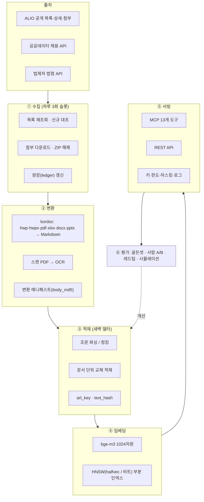

# 01. 전체 구조와 데이터 흐름

> 기준일 2026-11-26. 이 문서의 사실은 서버 코드, DB 조회, 내부 운영 문서에서 확인한 것만 적었고, 확인하지 못한 것은 «미확인»으로 표시했다.

## 1. 목적

공공기관 ALIO 공시 문서와 근거 법령을 **조문(청크) 단위**로 찾고, 근거를 인용해 답할 수 있게 하는 읽기 전용 서비스다. 핵심 원칙은 **정합성과 신뢰성**이다. 속도나 화려한 기능보다 «틀린 답을 그럴듯하게 내지 않는 것»을 우선한다. 그래서 응답마다 판본·효력·집계 범위·한계를 함께 싣는다.

## 2. 데이터 흐름

| 단계 | 하는 일 | 문서 |
|---|---|---|
| 수집 | ALIO 공개 페이지·API 와 법제처 API 에서 원본을 받고, 받은 사실을 원장에 남긴다 | [02](02_collection.md) |
| 변환 | 원본 문서를 Markdown 으로 바꾼다(스캔본은 OCR). 결과마다 본문 해시를 남긴다 | [03](03_conversion.md) |
| 적재 | Markdown 을 조문·청크로 나눠 PostgreSQL 에 넣는다. 문서 단위로 교체한다 | [04](04_load_embedding.md) |
| 임베딩 | 청크를 벡터로 만들고 HNSW 인덱스에 붙인다. 본문이 같으면 벡터를 공유한다 | [04](04_load_embedding.md) |
| 구조화 | 공시 표에서 값을 뽑아 `rag_ext` 표로 만들고, 공개용 뷰(`rag_sql`)를 만든다 | [05](05_database.md), [08](08_structured_cases_sql.md) |
| 서빙 | MCP·REST 로 검색·조회한다. 키별 한도·개인정보 마스킹·질의 로그를 둔다 | [06](06_search_serving.md), [07](07_mcp_tools.md) |
| 평가 | 골든셋, 사람 눈가림 A/B, 레드팀, 시뮬레이션으로 검증한다 | [09](09_evaluation.md) |

## 3. 구성 요소

| 구성 | 역할 | 비고 |
|---|---|---|
| 수집 슬롯 스크립트 | 07시·12시·19시(KST) 회차 수집 | a·c = 전체(입찰 제외), b = 입찰 경량 |
| 변환 워커(kordoc) | 문서 → Markdown | 서버 컨테이너 + 보조 서버, 대용량은 별도 러너 |
| 새벽 델타 | 04:35 에 어제 이후 바뀐 Markdown 만 파싱·적재·임베딩 | 기본 경로가 전체 TRUNCATE 가 아님 |
| PostgreSQL 18 | 본 DB. `pgvector` 0.8.7, `pg_bigm` 1.2, `pg_trgm` 1.6, `pg_prewarm` | 확장 버전은 2026-11-26 조회 |
| 임베딩 서버 | ollama 에서 bge-m3 를 GPU 로 실행 | 질의 임베딩도 같은 모델 |
| MCP 서버 | Node.js 단일 프로세스. stdio 와 Streamable HTTP(무상태) | 의존성은 `pg` 하나 |
| 게이트웨이 | TLS 종단, 키 검증은 서버 내부(`auth_tier`) | 내부 구성은 일반화 |
| 감시·알림 | 크론 + 웹훅 알림 | [10](10_operations.md) |

## 4. 코퍼스 4종과 별도 범위

| 코퍼스 | 키 | 단위 | 비고 |
|---|---|---|---|
| 경영공시 | `disclosure` | 공시 문서 → 청크(문서 수준 앵커) | 표·본문 청크. 공시 항목 코드(예 20201 임직원 수)가 있다 |
| 기관 내규 | `bylaws` | 조문 | 취업규칙·인사·보수 규정 등. 판본(연혁) 관리 |
| 단체협약 | `ca` | 조문(조문이 없으면 문단 청커 폴백) | 현행 판정은 폴더 연도 근사 |
| 법령 | `legal` | 조문 | 법제처. 시행일·판본·연혁·폐지 표식 |
| 출연연 내규 | `bylaws` + `scope=extra` | 조문 | 23곳. 기본 검색 제외, `search_extra` |

## 5. 설계 원칙 (코드와 문서에서 반복해서 확인되는 것)

1. **원본(raw)은 보존, 파생물은 재생성 가능**: Markdown·DB 는 원본에서 다시 만들 수 있어야 한다. 변환 결과의 비교는 꼬리 주석·머리말을 뗀 **본문 해시(body_md5)** 로 한다.
2. **해시가 정의다**: 청킹 규칙 세트·임베딩 입력 정의(컷·접두·모델·차원)가 `text_hash` 를 결정한다. 이 정의를 바꾸면 전량 재임베딩이므로 한 파일에서만 정의한다([04](04_load_embedding.md)).
3. **문서 단위 교체**: 증분 적재는 «있는 문서»를 통째로 지우고 다시 넣는다(트랜잭션). 청크 일부만 고치지 않는다.
4. **플래그로 켜는 기능, 꺼진 기능은 바이트 동일**: 서빙의 신규 기능은 환경 플래그가 꺼져 있으면 도구 목록·응답이 종전과 같다. 롤백은 플래그와 이미지 태그로 한다([10](10_operations.md)).
5. **응답에 한계를 싣는다**: `exhaustive=false`, `coverage`, `caveats`, `edition_warning`, `zero_reasons`, «찾지 못함≠없음» 같은 필드·문구를 도구가 직접 낸다.
6. **읽기 전용·최소 권한**: SQL 도구는 전용 읽기 롤과 뷰 화이트리스트, 구조화 조회는 값 바인딩·허용 인자만([08](08_structured_cases_sql.md)).
7. **공개 서비스의 정직함**: 마스킹 한계, 사례 카드가 표본이라는 점, 순위·최다 단정 금지를 문서와 응답에 모두 명시한다.

## 6. 규모 요약 (2026-11-26)

공식 집계와 정의는 [README](../README.md#규모-2026-11-26-기준)를 따른다. 직접 조회한 값(같은 날):

- `documents` 679,591행(공시 607,629 · 내규 47,036[출연연 4,407 포함] · 단체협약 21,244 · 법령 3,682)
- `articles` 11,890,030행, `article_embeddings` 6,949,400행(모델 라벨 2종: `baai/bge-m3` 6,793,974 · `bge-m3` 155,426. 같은 모델을 다른 서빙 경로에서 부른 표기 차이로 추정되나 «미확인»)
- 기관 378곳(공시대상 355 + 출연연 23), `load_runs` 87행(`delta` 82 · `full` 3 · `append` 2)
- 법령 3,682문서 = 현행 정본 557 + 연혁 3,125(2015년 이후 연혁 포함; 보강 작업 보고서 기준). `edition_status` 분포는 superseded 3,105 · current 165 · scheduled 110 · 표식 없음 302(2026-11-26 직접 조회, 정의가 달라 위 구분과 다름). `documents.alias`(법령 약칭)는 법령 3,682건 전부 NULL 이다.

## 7. 그림에 대하여

이 저장소의 그림은 mermaid 로 문서 안에 직접 넣었다. 기존 도해(HTML)에는 내부 호스트·경로 정보가 섞여 있어 복사하지 않았다.
